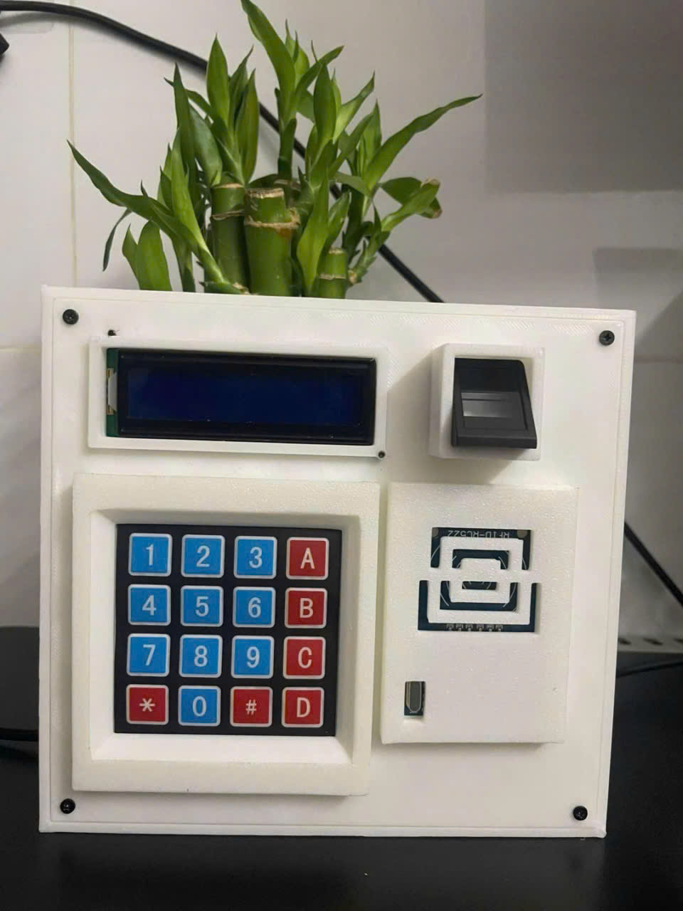
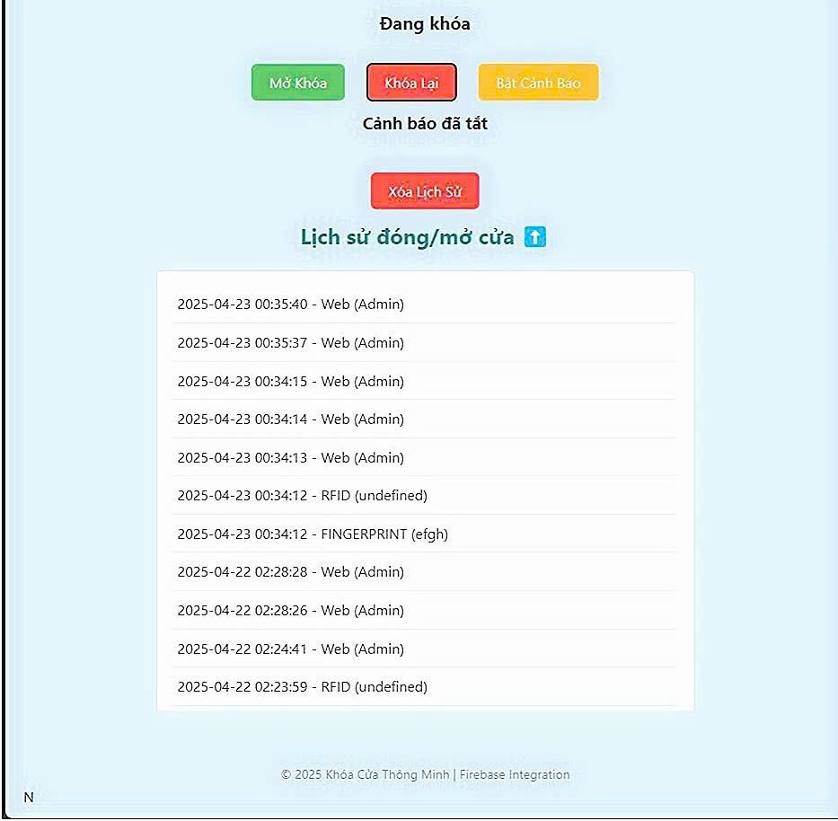

# ESP32-Based Smart Door Lock System

## 1. Project Overview

The **Smart Door Lock System** is an embedded IoT project designed to provide secure and convenient access control using an ESP32 microcontroller.

The system integrates three authentication methods: **RFID card, fingerprint recognition, and keypad password**. After successful authentication, the ESP32 controls a solenoid door lock to grant access.

In addition to local authentication, the system provides a web-based management interface through Wi-Fi and HTTP. Users can remotely monitor door status, manage authorized users, review access logs, and control the locking mechanism.

## 2. System Architecture



The system consists of four main functional components:

- **ESP32 Controller:** Acts as the central processing unit, handling authentication, peripheral communication, access control logic, and web server operations.
- **RFID Authentication:** Uses the MFRC522 module to read RFID cards through the SPI communication interface.
- **Fingerprint Authentication:** Integrates the AS608 fingerprint sensor through UART to perform fingerprint identification.
- **Keypad and Door Lock Control:** Processes password input from the keypad and controls the LY-03 solenoid lock based on authentication results.

The ESP32 also provides Wi-Fi connectivity for communication with the web-based management interface.

## 3. Hardware Design

### Main Hardware Components

| Component | Function |
|---|---|
| ESP32 | Main controller and Wi-Fi connectivity |
| MFRC522 | RFID card identification via SPI |
| AS608 | Fingerprint recognition via UART |
| Keypad | Password-based authentication |
| LY-03 Solenoid Lock | Electronic door locking mechanism |
| Power Supply | Provides power to the control system and peripherals |

## 4. Firmware and Software Implementation

### 4.1. Embedded Firmware

**Source code:** `ESP32_automaticdoor_THEMTHE/`

- Developed firmware using C/C++ on the ESP32 platform.
- Implemented authentication processing for RFID cards, fingerprints, and keypad passwords.
- Integrated the MFRC522 RFID module through SPI communication.
- Established UART communication with the AS608 fingerprint sensor.
- Processed authentication results and controlled the LY-03 solenoid lock.
- Implemented access control logic to manage authorized and unauthorized entry attempts.

### 4.2. Web Server and Remote Management

**Source code:** `Autodoor_WebServer/`

- Developed a web server on ESP32 to provide remote access management over Wi-Fi and HTTP.
- Built a web interface using HTML, CSS, and JavaScript.
- Supported user management and access permission administration.
- Displayed door lock status and access history.
- Enabled remote door locking and unlocking.

## 5. Web Monitoring Interface



The web dashboard provides a centralized interface for monitoring and managing the smart door lock system.

Main functions include:

- Monitoring the current door lock status.
- Managing authorized users.
- Viewing access logs and authentication history.
- Remotely controlling the door locking mechanism through the web interface.

## 6. Repository Structure

```text
smartLock_esp32/
├── Autodoor_WebServer/
│   └── ESP32 Web Server and Dashboard
│
├── ESP32_automaticdoor_THEMTHE/
│   └── ESP32 Embedded Firmware
│
├── images/
│   ├── system_overview.jpg
│   └── website.jpg
│
└── README.md
```

## 7. Technologies Used

- **Programming Languages:** C, C++, HTML, CSS, JavaScript
- **Microcontroller:** ESP32
- **Authentication:** RFID, Fingerprint Recognition, Keypad Password
- **Communication Protocols:** SPI, UART, Wi-Fi, HTTP
- **Hardware Modules:** MFRC522, AS608, LY-03 Solenoid Lock
- **Development Environment:** Arduino IDE

## 8. Project Objectives

- Develop a multi-method electronic door access control system.
- Integrate RFID, fingerprint, and keypad-based authentication.
- Implement embedded firmware for authentication processing and solenoid lock control.
- Develop a web-based interface for remote monitoring and access management.
- Improve convenience and flexibility in electronic door access control.